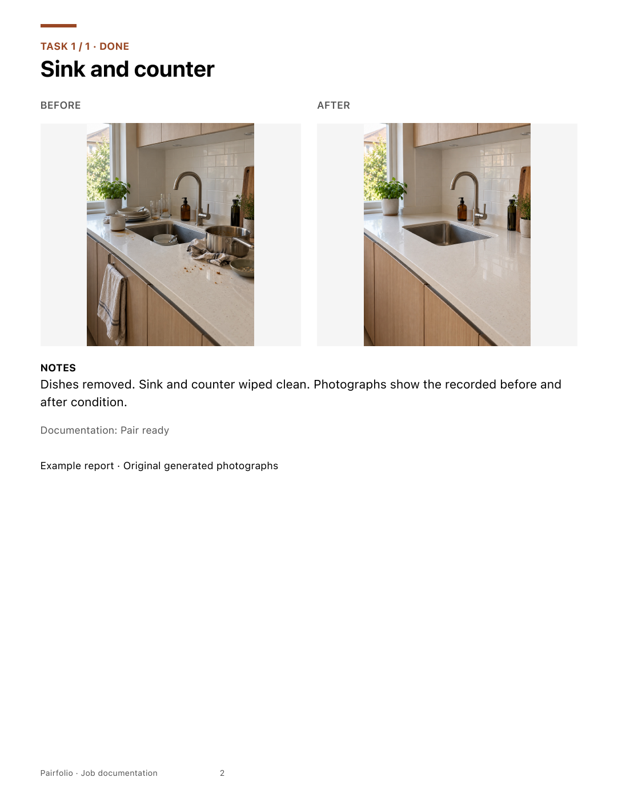
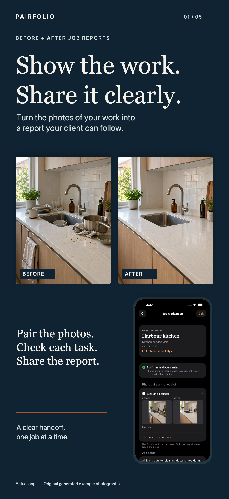
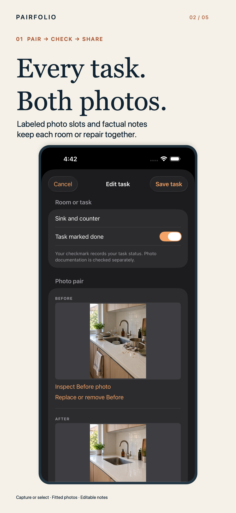
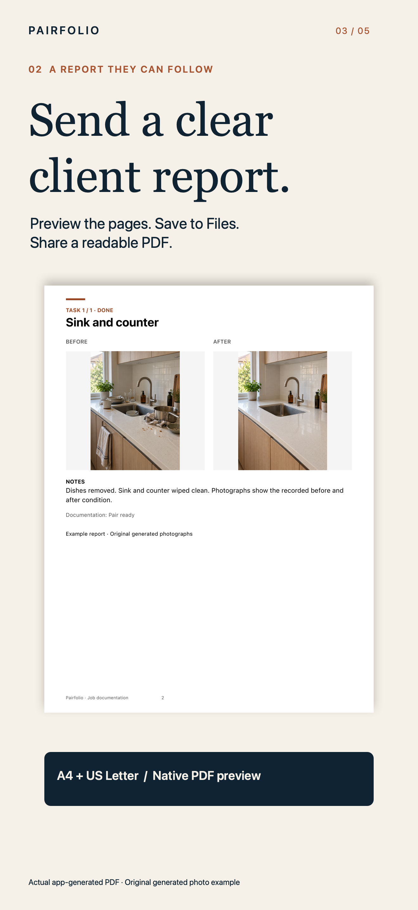
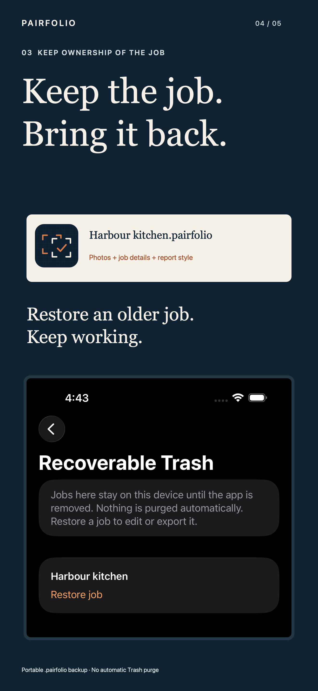
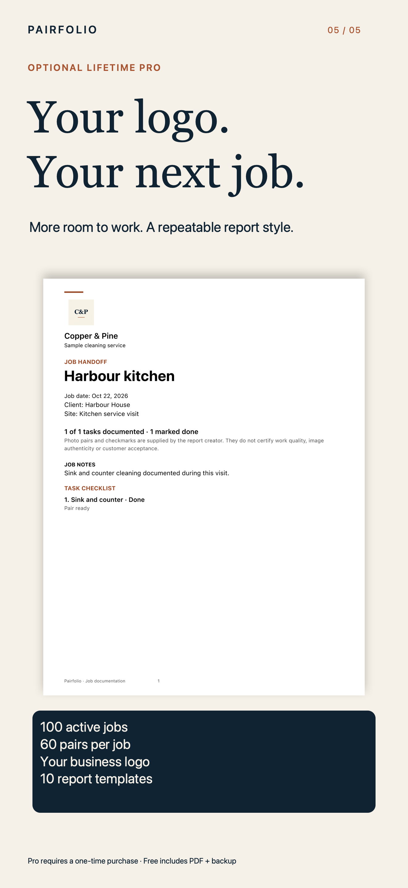
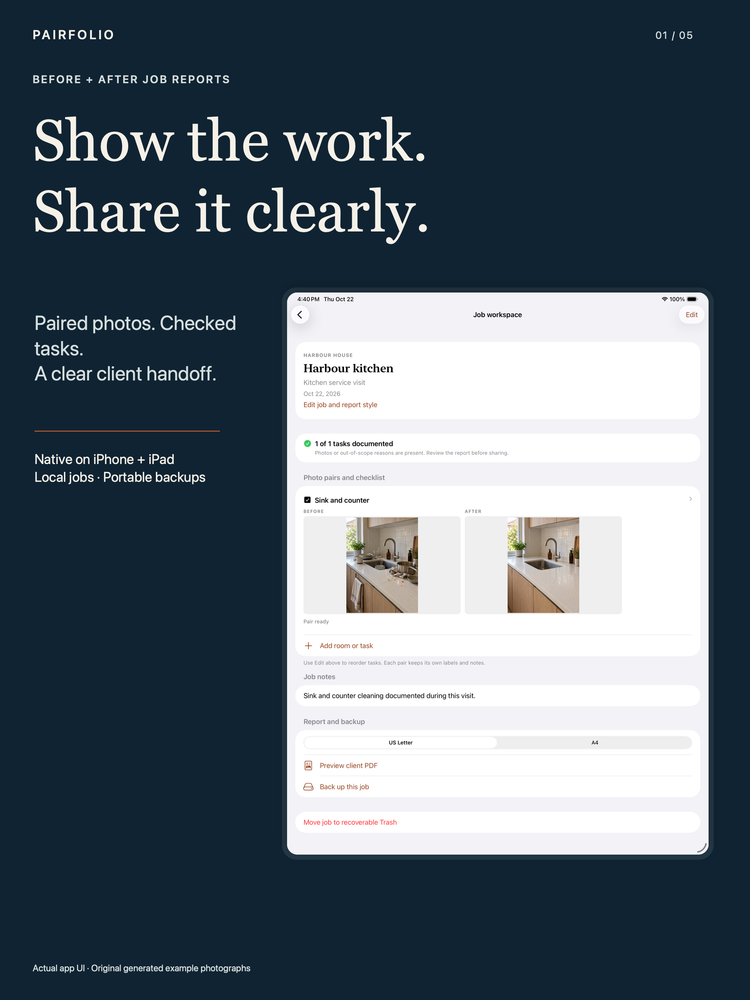
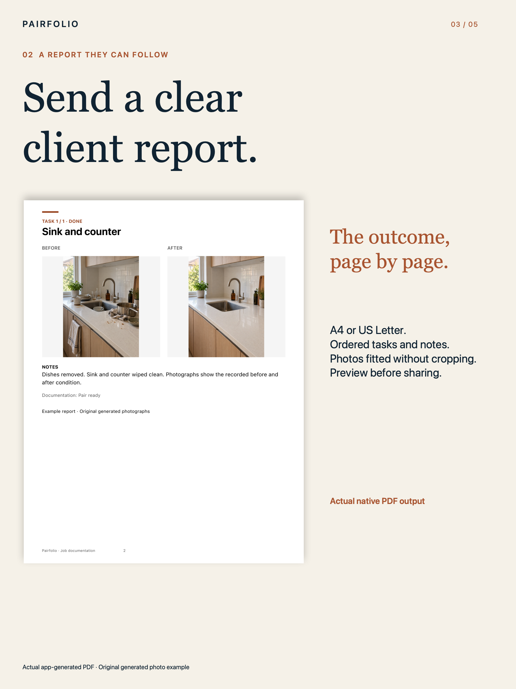
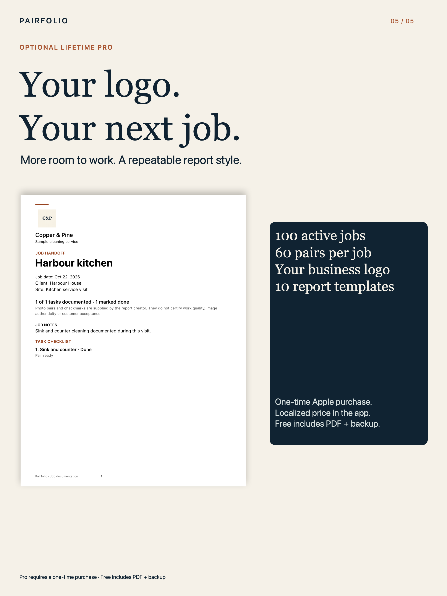

# Pairfolio: Before After Photos

**Show the work. Share clearly.**

Native iPhone/iPad job handoffs for solo cleaners, handymen and maintenance operators. Labeled Before/After slots, a task checklist and factual notes become a readable client PDF, with portable local job backups and recoverable Trash.

**Status · October 22, 2026:** Version 1.0(3) and Lifetime Pro were submitted together at 22:18 PDT and are Waiting for Review. No approval or public release is claimed. V1 is frozen; TestFlight distribution is skipped by publisher instruction. Commercial source is private. This repository contains only the professional product showcase and original presentation assets.

[Product showcase](https://sepidehdalir.github.io/pairfolio/) · [Workflow and support](https://sepidehdalir.github.io/pairfolio/support.html) · [Privacy](https://sepidehdalir.github.io/pairfolio/privacy.html)

## Product and engineering

Each task has explicit Before/After slots, editable labels, fitted photographs and short notes. Task checkmarks are separate from documentation completeness. Missing photos stay visible; incomplete reports are labeled Draft. A task outside the job's scope needs a reason. Reports describe creator-supplied documentation without authenticity, work-quality or legal-evidence guarantees.

SwiftUI and UIKit target Universal iOS/iPadOS15+ using the current SDK. ImageIO bounds input and creates oriented JPEG copies. Core Graphics builds A4/Letter PDFs with ordered tasks, photographs, notes and pagination. Actor-serialized atomic writes preserve previous metadata on failed saves. Content-addressed media, strict versioned backup validation, fresh restore identities and recoverable Trash protect local ownership.

StoreKit 2 loads localized product prices, verifies purchase access, handles pending/cancellation/errors, supports offline verified access and restoration. Free includes one active job, three pairs, the editing/checklist workflow, PDF and backup. Optional Lifetime Pro adds 100 active jobs, 60 pairs/job, a logo and 10 reusable report templates. Existing work remains editable and exportable if Pro is unavailable.

## Evidence and privacy

Private dated production records distinguish model/image/PDF tests, actual native UI workflows and local StoreKit tests from physical-device and genuine Apple Sandbox results. Six native tests also passed on a physical iPhone 17 Pro Max/iOS 27.2. The publisher separately reported that camera/owned-photo, saved PDF/backup, Trash/relaunch/fresh import and genuine Apple Sandbox purchase/Pro/relaunch/Restore checks all passed. These owner-reported observations remain separate from automated/local StoreKit receipts. Joint App Review receipt: ae9e87d9-69b5-4f6a-9888-f59f8ac70ccb. Actual iOS 15 runtime was unavailable; compilation at15minimum is separate from native execution on installed17/26.5 runtimes.

There is no developer backend, account, ad SDK or analytics uploader. Photos and jobs are processed locally; Apple manages purchases and users select their own Files/share destinations. The example photographs are original generated images, imported and rendered through the real app. They are not actual customer jobs. The shown PDF is actual native output. Five dedicated iPhone and five iPad campaign exports use stabilized actual native UI and real PDF output, with full-size and App Store thumbnail review. The example Copper & Pine logo is an original fictional business sample.

Designed and engineered by **Sepideh Javanbakht Dalir** · [Arvinify](https://www.arvinify.com) · [hello@arvinify.com](mailto:hello@arvinify.com)

## Premium product campaign

     

   
